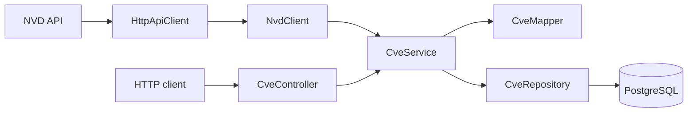

# CyberPulse

I'm building a threat intelligence dashboard one phase at a time. Right now it pulls newly published CVEs from the NVD API, cleans them up, and stores them in PostgreSQL behind a REST API.

**Status:** Phase 1 of 9 in progress. NVD ingestion works; scheduled polling is next. The rest is in the [roadmap](#roadmap).

## What it does today

- Pulls CVEs published in the last 24 hours from the [NVD CVE API 2.0](https://nvd.nist.gov/developers/vulnerabilities) (up to 2,000 per sync; paging comes later)
- Keeps the English description and the CVSS v3.1 score. If NVD scored it, I use NVD's score. If NVD hasn't scored it yet, I use the first score another source provided.
- Saves everything to PostgreSQL. Running the sync again updates CVEs I already have, so nothing gets duplicated.
- If one CVE has bad data, it gets logged and skipped. The rest of the batch still saves.

## How it's put together



| Class | Job |
|---|---|
| `CveController` | HTTP endpoints |
| `CveService` | Runs the sync: fetch, parse, map, save |
| `NvdClient` | Builds the NVD request (URL, 24-hour window, encoding) |
| `HttpApiClient` | Makes the HTTP call and handles timeouts, errors, and logging. Every future API client will share it. |
| `CveMapper` | Turns NVD's nested JSON into my flat `Cve` entity |
| `CveRepository` | Database access through Spring Data JPA |

## Tech stack

Java 21, Spring Boot 4, Spring Data JPA with Hibernate, PostgreSQL 16, Docker Compose, JUnit 6, Mockito

## Running it locally

You'll need Java 21 and Docker.

1. Start PostgreSQL:
```bash
   docker compose up -d
```

2. Start the app:
```bash
   ./mvnw spring-boot:run
```

3. Pull the latest CVEs from NVD:
```bash
   curl -X POST http://localhost:8080/api/cves/sync
```
   You'll get back how many CVEs were processed, like `{"saved":611}`.

4. Read them back:
```bash
   curl http://localhost:8080/api/cves
```

If Docker says port 5432 is taken, you probably have a local PostgreSQL running. I hit this myself. Run `lsof -i :5432` to find it and stop it first.

## API

| Method | Endpoint | What it does |
|---|---|---|
| `GET` | `/api/cves` | Lists the CVEs in the database |
| `POST` | `/api/cves/sync` | Pulls the last 24 hours of CVEs from NVD and saves them |

## Tests

```bash
./mvnw test
```

Most tests mock anything external. One context test starts the full app, so run `docker compose up -d` first.

There's also one integration test that calls the real NVD API. I left it out of the default run so an NVD outage can't break the build. Run it with:

```bash
./mvnw test -Dgroups=integration
